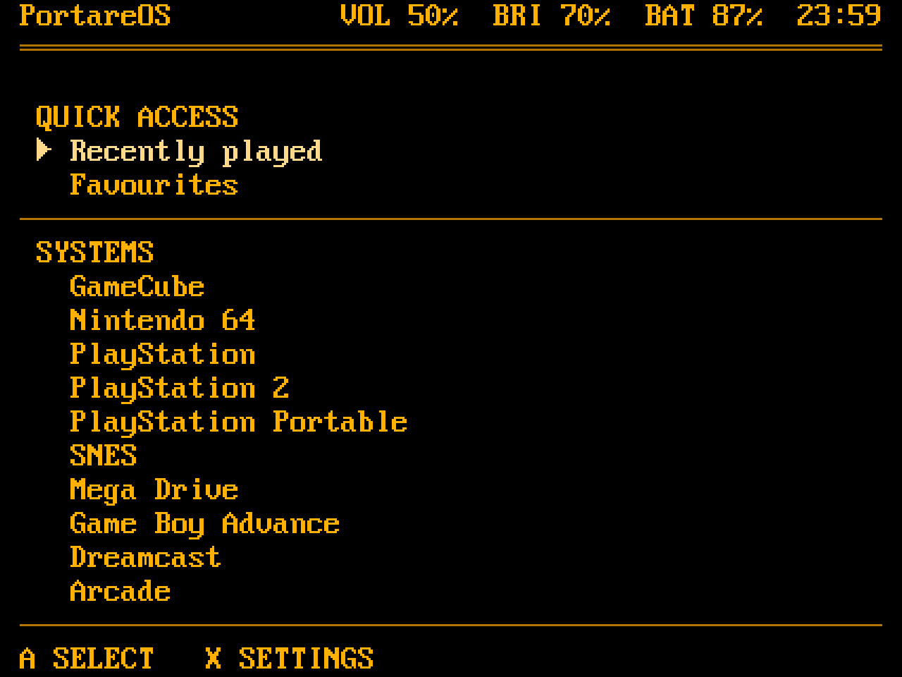
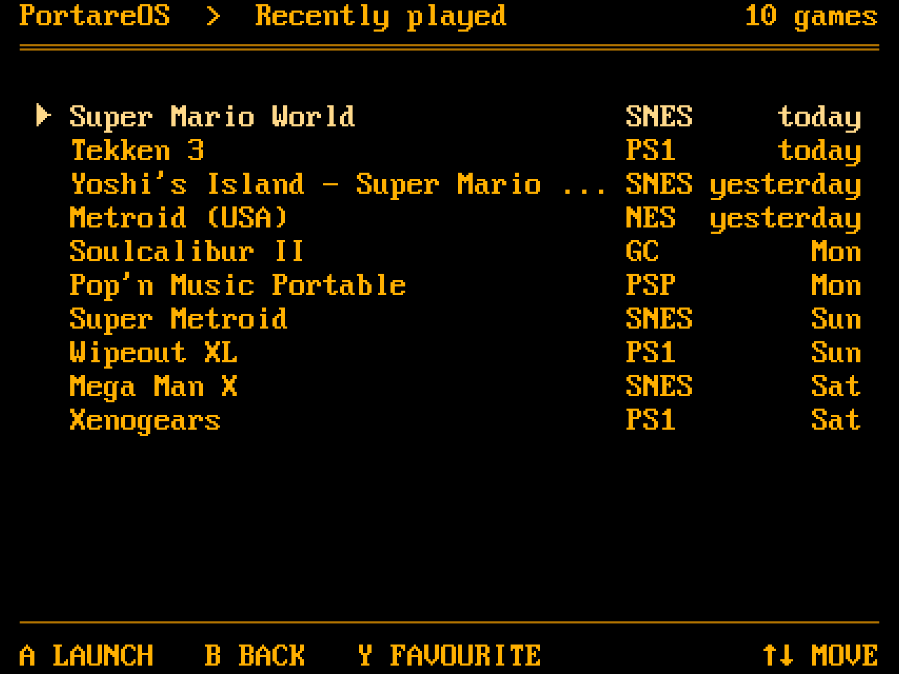
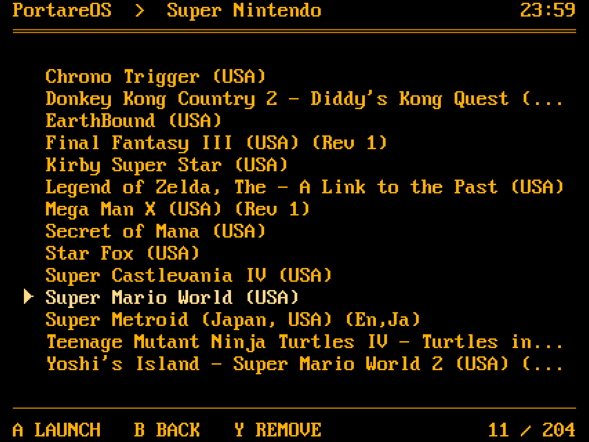
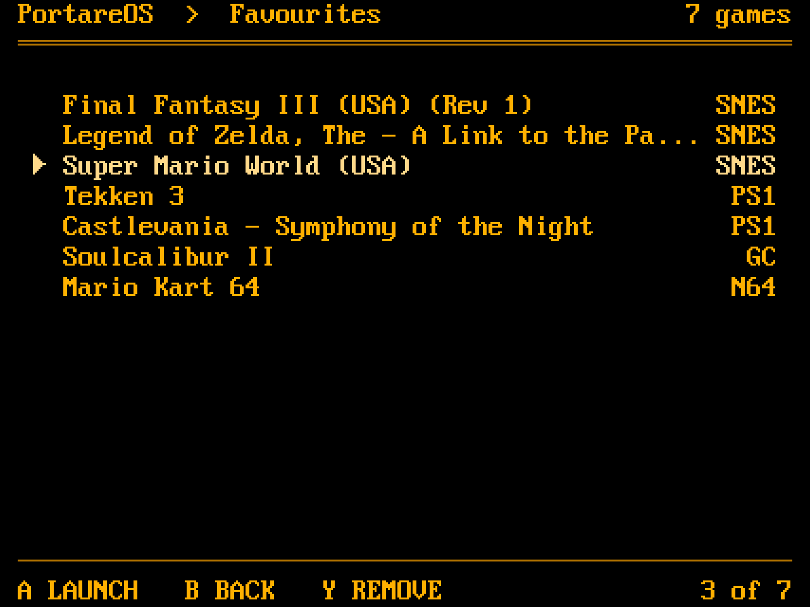
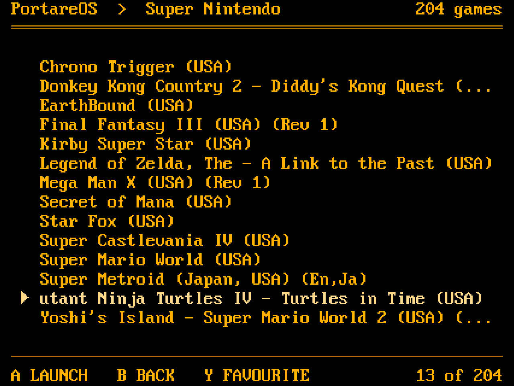

# Quick Access, Recently played, Favourites, long titles

A tester who filled several systems asked for a way back to a game
without scrolling the whole list, and for titles that do not stop at the
edge of the panel. The screens are in `docs/mockup.txt` under PROPOSED,
generated by `tools/mockup.py`, and rendered one image per screen in
`docs/images/` by `tools/mockup_png.py` with the launcher's fonts. These
features are implemented; PROPOSED is an old mockup label. The mockups use
separate layouts and colours, so they are not exact captures of the current UI.

## Quick Access

A category of its own above the systems: cross-system shortcuts first,
platforms below, a thin rule between and no blank row. Recently played
comes first because it needs no curation. The systems section keeps its
title and loses its count: the list is the count. Quick Access is always
shown. The Systems screen keeps the device's status in its header when
it fits. A list of games, Recently played and Favourites included,
carries only its crumb and the clock at the right edge: no volume,
brightness or battery there. A system's games list puts its position and
total in the footer; Recently played and Favourites have no count.
The games screen no longer names the emulator under the
list; which core runs a system is not the player's concern.

The mockup's system order is illustrative; the launcher sorts systems by
their configured full names, ignoring ASCII case.

## Recently played

Up to ten games, newest first, grouped under the day they exited as a
heading: `TODAY`, `YESTERDAY`, then the weekday for the last week and the
date beyond it.
A row is the title and a short system name; the day is not a third
column. Short names (PS1, PS2, PSP, N64, GBA, GC, DC, SNES, NES) in the
cross-system views only; the Systems screen keeps the full names. The
footer is the favourite cue as everywhere, and carries no position. The
sample fills the panel because its ten games fall on five days; ten games
on ten days need twenty rows, so the list scrolls like any other, and the
day headings scroll with their games. An entry is written when the launch
script (normally `runemu.sh`) exits with status 0. Home + START records the
game too if the script completes successfully; a failed launch is not recorded.
The list is saved in `/storage/.config/portarelauncher/recent`.

## Favourites

One file, a game path per line, at
`/storage/.config/portarelauncher/favourites`, in insertion order. It is
pruned of paths that no longer exist when a cross-system list opens, so a
renamed or deleted ROM leaves no dead row. `Y` toggles the selected game
wherever a game is listed, and the footer is the cue: `Y FAVOURITE` under a game
that is not one, `Y REMOVE` under one that is, in every list. Nothing in
the list itself marks a favourite, and the footer names each key and its action.
With shape marks selected, Square takes the place of `Y`.

The Favourites mockup still shows `3 / 7`; the current screen has no position count.

## Long titles

On the 53-column grid, a system's title column is 47 display columns once
the marker, the indent and the right margin are taken. A title longer than
that is cut to the column with `...` while it is not selected. The selected
row scrolls instead: still
for one second, then one column to the left every 150 ms until the end is
in view, 1.5 seconds there, back to the start, and again. No wrap, so the
ending the reader was after is not followed by what they already read.
Only the selected row ever moves.

In a system's games list, the position, `9 / 204`, sits at the right end
of the footer where the `↑↓ MOVE` hint was; a d-pad needs no hint. The row
the count had, and the blank rows around it, go to the list: fourteen games
on screen instead of ten.

